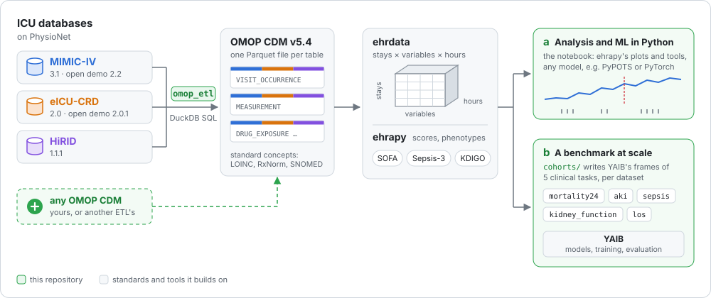

# Analysis and machine learning across ICU datasets with OMOP and ehrapy

Machine learning tasks for intensive care on the OMOP Common Data Model. This repository turns MIMIC-IV, eICU and
HiRID into one OMOP CDM and defines the tasks of the ICU benchmark [YAIB](https://github.com/rvandewater/YAIB) on it:
ICU mortality, kidney function, length of stay, acute kidney injury and sepsis. [ehrdata](https://github.com/theislab/ehrdata)
reads the CDM into Python, and [ehrapy](https://github.com/theislab/ehrapy) computes the clinical scores and
phenotypes behind the labels: SOFA, Sepsis-3 and the KDIGO stages of acute kidney injury.

## What you can do with it



a) Analysis and machine learning in Python. [The notebook](cohorts/notebooks/omop_ehrdata_ehrapy_pypots.ipynb) goes
from a CDM to a trained model. ehrdata reads the ICU stays into an `EHRData` of hourly variables; ehrapy derives SOFA,
Sepsis-3 and KDIGO and plots the course of a stay; a GRU-D model of [PyPOTS](https://github.com/WenjieDu/PyPOTS)
predicts acute kidney injury from the first 24 hours, trained through ehrapy's `ep.ml` and with PyPOTS alone. Any model
that takes arrays fits in its place. The notebook is stored with the outputs of a run on the MIMIC-IV demo: GitHub shows
its text and tables, and Jupyter or
[nbviewer](https://nbviewer.org/github/theislab/icu-omop-cohorts/blob/main/cohorts/notebooks/omop_ehrdata_ehrapy_pypots.ipynb)
also its interactive plots.

b) A benchmark at scale. `cohorts/` writes YAIB's `dyn`, `sta` and `outc` frames of its five tasks for each dataset,
with the cohorts, exclusions and label definitions of YAIB's own. YAIB's models, training and evaluation run on them as
on its own cohorts:

```bash
icu-benchmarks train -d <cohorts>/frames/mortality24/miiv -n miiv -t BinaryClassification -m LGBMClassifier
```

## Why OMOP

We want analyses such as ICU benchmarks to be built across multiple databases at a time. YAIB's cohorts come from [ricu](https://github.com/eth-mds/ricu),
an R package that maps the items of each database to a concept dictionary of its own. The OMOP CDM is the format that
hospitals and research networks already use for their health records, with standard concepts (LOINC, RxNorm, SNOMED)
for what was measured and given. Defining the tasks on OMOP splits the work in two:

- getting a database into OMOP, done once per database, and done by several projects (see
  [Other routes to OMOP](#other-routes-to-omop));
- phenotyping and defining the tasks, which then works on any CDM that records the same standard concepts.

The harmonized CDM is an intermediate step in its own right. It holds the three databases in one schema and one set of
concepts, so researchers who know OMOP can build their own analyses, cohorts and tools on it with the OHDSI ecosystem
or anything that reads Parquet, rather than what this repository does with it. This repository does both halves for
three ICU databases on PhysioNet, and its focus is the second: a quick and efficient path from a CDM to phenotypes,
labels and data ready for machine learning.

## Quick start: the demos

The MIMIC-IV and the eICU Collaborative Research Database demos are open data, so the whole pipeline runs without
credentials:

```bash
git clone https://github.com/theislab/icu-omop-cohorts && cd icu-omop-cohorts
uv sync
uv run bash ci/demo.sh demo
```

`ci/demo.sh` downloads the [MIMIC-IV demo](https://physionet.org/content/mimic-iv-demo/2.2/) (100 patients, 140 ICU
stays) and the [eICU demo](https://physionet.org/content/eicu-crd-demo/2.0.1/) (2,520 ICU stays from 20 hospitals)
into `demo/`, and then

1. builds the OMOP CDM of both in `demo/omop/cdm`,
2. builds the frames of all five tasks for both datasets in `demo/omop/cohorts/frames`,
3. runs the notebook on the CDM of the MIMIC-IV demo into `demo/notebooks`.

This takes about 4 minutes, plus the downloads from PhysioNet. The vocabulary is a small fixture with the concepts the
demos use, `omop_etl/tests/fixtures/vocabulary`, which keeps names only for UCUM and the vocabularies OMOP generates
itself. `OMOP_VOCABULARY=<dir>` points the run at an Athena download instead.

To work in the notebook afterwards: `uv run jupyter lab`, and open `cohorts/notebooks/omop_ehrdata_ehrapy_pypots.ipynb`,
which reads `demo/omop/cdm_mimic4` unless `OMOP_CDM` names another CDM.

## Install

You need [uv](https://docs.astral.sh/uv/). It installs Python 3.13 if that is missing.

```bash
uv sync                               # or, with the settings of config.env: source env.sh
cp config.example.env config.env      # optional: your paths and cluster settings (gitignored)
```

One environment serves the ETL, the cohorts and the notebook. ehrdata and ehrapy are pinned to commits on GitHub until
their next releases contain what the builder uses: ehrdata's `person_visit_detail` and ehrapy's `tl.sofa`,
`tl.sepsis3`, `tl.kdigo` and `tl.mark_events`.

`config.env` holds what differs between machines: the CDM to read (`OMOP_CDM`), where outputs may go, the SLURM
partition and QOS, the data of the tests, and where uv keeps the environment. `source env.sh` reads it, builds the
environment and activates it; the SLURM scripts and their jobs start that way. It stays out of git, so your paths never
reach a fork.

## The full data

1. Get credentialed access on [PhysioNet](https://physionet.org) to
   [MIMIC-IV 3.1](https://physionet.org/content/mimiciv/3.1/), [eICU-CRD 2.0](https://physionet.org/content/eicu-crd/2.0/)
   and [HiRID 1.1.1](https://physionet.org/content/hirid/1.1.1/), and download what you need.
2. Download a vocabulary from [Athena](https://athena.ohdsi.org): at least SNOMED, LOINC, RxNorm, UCUM, Gender, Visit,
   Type Concept and OMOP Extension.
3. Build the CDM: copy `omop_etl/config.example.yaml` to `omop_etl/config.local.yaml`, fill in the paths, and run
   `python -m omop_etl convert`, `stage` and `cdm`. It takes about 7 minutes for all three on a SLURM cluster
   (`omop_etl/slurm/submit_all.sh`); [`omop_etl/README.md`](omop_etl/README.md) has the steps, resources and checks.
4. Analyse: point the notebook at the CDM with `OMOP_CDM=<out_dir>/cdm`.
5. Or build YAIB's frames: with `OMOP_CDM` set, run `cohorts/prefilter.py` per dataset and `cohorts/build_cohort.py`
   per dataset and task ([`cohorts/RUNBOOK.md`](cohorts/RUNBOOK.md); `omop_etl/tools/run_cohorts.sh` submits the
   whole chain on SLURM), then train with YAIB.

## Other routes to OMOP

The ETL here is one of several, and these are excellent:

- [OHDSI's MIMIC-IV ETL](https://github.com/OHDSI/MIMIC), the community's conversion of MIMIC-IV. Our measurement
  concepts follow its choices ([`omop_etl/docs/OHDSI-MIMIC.md`](omop_etl/docs/OHDSI-MIMIC.md)).
- [BlendedICU](https://github.com/USM-CHU-FGuyon/BlendedICU) (Oliver et al., J Biomed Inform 2023), which harmonizes
  several ICU databases into OMOP. It was this project's first route to OMOP, and our mapping tables started from its.
- [omopetl](https://github.com/tompollard/omopetl), declarative table-level mappings from tabular health records to
  OMOP CDM 5.4, with the MIMIC-IV demo as its example.

They sometimes diverge, in concepts, units or the timeline.
[`omop_etl/docs/DIFFERENCES.md`](omop_etl/docs/DIFFERENCES.md) gives our conventions and where they depart from
BlendedICU's, and [`OHDSI-MIMIC.md`](omop_etl/docs/OHDSI-MIMIC.md) the comparison with OHDSI's concepts. Our mappings
are plain tables in `omop_etl/mappings/`. They are candidates to keep in sync with these efforts, or to replace with
theirs, as you prefer.

## Layout and documentation

| Path | What |
|---|---|
| [`omop_etl/`](omop_etl) | the ETL, its mappings, tests and tools; [`README.md`](omop_etl/README.md) runs it step by step, [`docs/`](omop_etl/docs) has the CDM's conventions and the comparisons with BlendedICU and OHDSI |
| [`cohorts/`](cohorts) | the cohort builder, its tests and the notebook; [`RUNBOOK.md`](cohorts/RUNBOOK.md) builds the frames, task by task |
| [`RICU.md`](RICU.md) | where the cohorts follow ricu, where they deliberately differ, and the errors in ricu's definitions we found |
| [`ci/`](ci) | the demo run, the downloads of the demos, and the check that keeps data files out of commits |
| `pyproject.toml`, `uv.lock`, `env.sh`, `config.example.env` | the environment and the settings of a checkout |

## Development

```bash
uv run pytest                     # the ETL and cohort tests; the MIMIC-IV demo test needs MIMIC_IV_DEMO=<demo dir>
uv run pre-commit install         # ruff, file hygiene and ci/check_files.py before each commit
uv run pre-commit run --all-files
```

CI (`.github/workflows/ci.yml`) runs the pre-commit checks, the tests with the MIMIC-IV demo, and `ci/demo.sh`.

The notebook's stored outputs come from the MIMIC-IV demo. After `ci/demo.sh demo`, this runs it again on the demo's CDM
and stores the new outputs:

```bash
uv run jupyter nbconvert --to notebook --execute --inplace --ExecutePreprocessor.record_timing=False \
    cohorts/notebooks/omop_ehrdata_ehrapy_pypots.ipynb
```

Never commit patient data or anything derived from it. Outputs go to directories outside the repository, the
`.gitignore` blocks data formats, and `ci/check_files.py` rejects data files and notebooks with outputs. It accepts
the outputs of this one notebook only from the MIMIC-IV demo, by the demo's 140 stays of 100 persons in the cell that
counts them. The repository's only data are the mapping tables, the vocabulary fixture and these demo outputs.

## Data

MIMIC-IV, eICU-CRD and HiRID are on PhysioNet under credentialed access; the MIMIC-IV and eICU-CRD demos are open,
under the Open Database License (ODbL) v1.0. The notebook's stored outputs contain information from the MIMIC-IV
Clinical Database Demo v2.2, which is made available under the
[ODbL v1.0](https://opendatacommons.org/licenses/odbl/1-0/). Cite the datasets you use as below and as their PhysioNet
pages ask.

## License

Apache-2.0 ([`LICENSE`](LICENSE)). [`NOTICE`](NOTICE) lists the third-party material and its licenses: the mapping
tables first taken from BlendedICU, YAIB-cohorts' antibiotic sets, HIRID-ICU-Benchmark's item names, OHDSI's CDM schema and concept
choices, the OMOP vocabularies and UCUM of the test fixture, and the MIMIC-IV demo; and how the cohort rules relate to
ricu.

## Acknowledgements

This work is closely related to and builds on:

- **YAIB**, whose tasks and cohorts this repository rebuilds on OMOP:
  van de Water R, Schmidt H, Elbers P, Thoral P, Arnrich B, Rockenschaub P. Yet Another ICU Benchmark: A Flexible
  Multi-Center Framework for Clinical ML. ICLR 2024. [arXiv:2306.05109](https://arxiv.org/abs/2306.05109).
  Repositories: [YAIB](https://github.com/rvandewater/YAIB) and [YAIB-cohorts](https://github.com/rvandewater/YAIB-cohorts).
- **ricu**, which builds YAIB's cohorts and whose rules the cohort builder reproduces ([`RICU.md`](RICU.md)):
  Bennett N, Plečko D, Ukor I-F, Meinshausen N, Bühlmann P. ricu: R's interface to intensive care data. GigaScience
  12, giad041 (2023). [doi:10.1093/gigascience/giad041](https://doi.org/10.1093/gigascience/giad041).
  Repository: [ricu](https://github.com/eth-mds/ricu).
- **The OHDSI MIMIC-IV mapping**, whose concepts our measurements follow: [OHDSI/MIMIC](https://github.com/OHDSI/MIMIC),
  and Kallfelz M, Tsvetkova A, Pollard T, et al. MIMIC-IV demo data in the OMOP Common Data Model, version 0.9.
  PhysioNet 2021. [doi:10.13026/p1f5-7x35](https://doi.org/10.13026/p1f5-7x35).
- **BlendedICU**, this project's first route to OMOP, from whose files some of our mapping tables were first taken
  ([`NOTICE`](NOTICE)): Oliver M, Allyn J, Carencotte R, Allou N, Ferdynus C. Introducing the BlendedICU dataset, the
  first harmonized, international intensive care dataset. Journal of Biomedical Informatics 146, 104502 (2023).
  [doi:10.1016/j.jbi.2023.104502](https://doi.org/10.1016/j.jbi.2023.104502).
  Repository: [BlendedICU](https://github.com/USM-CHU-FGuyon/BlendedICU).
- **The datasets:**
  - Johnson AEW, Bulgarelli L, Shen L, et al. MIMIC-IV, a freely accessible electronic health record dataset.
    Scientific Data 10, 1 (2023). [doi:10.1038/s41597-022-01899-x](https://doi.org/10.1038/s41597-022-01899-x).
  - Pollard TJ, Johnson AEW, Raffa JD, Celi LA, Mark RG, Badawi O. The eICU Collaborative Research Database, a freely
    available multi-center database for critical care research. Scientific Data 5, 180178 (2018).
    [doi:10.1038/sdata.2018.178](https://doi.org/10.1038/sdata.2018.178).
  - Hyland SL, Faltys M, Hüser M, et al. Early prediction of circulatory failure in the intensive care unit using
    machine learning. Nature Medicine 26, 364-373 (2020).
    [doi:10.1038/s41591-020-0789-4](https://doi.org/10.1038/s41591-020-0789-4). Faltys M, Zimmermann M, Lyu X,
    Hüser M, Hyland S, Rätsch G, Merz T. HiRID, a high time-resolution ICU dataset, version 1.1.1. PhysioNet 2021.
    [doi:10.13026/nkwc-js72](https://doi.org/10.13026/nkwc-js72).
  - The demos: Johnson A, Bulgarelli L, Pollard T, Horng S, Celi LA, Mark R. MIMIC-IV Clinical Database Demo, version
    2.2. PhysioNet 2023. [doi:10.13026/dp1f-ex47](https://doi.org/10.13026/dp1f-ex47). Johnson A, Pollard T, Badawi O,
    Raffa J. eICU Collaborative Research Database Demo, version 2.0.1. PhysioNet 2021.
    [doi:10.13026/4mxk-na84](https://doi.org/10.13026/4mxk-na84).
- **PhysioNet:** Goldberger AL, Amaral LAN, Glass L, et al. PhysioBank, PhysioToolkit, and PhysioNet: components of a
  new research resource for complex physiologic signals. Circulation 101(23), e215-e220 (2000).
  [doi:10.1161/01.CIR.101.23.e215](https://doi.org/10.1161/01.CIR.101.23.e215).

OHDSI's MIMIC-IV ETL, BlendedICU and omopetl are the routes to OMOP we learned from.
